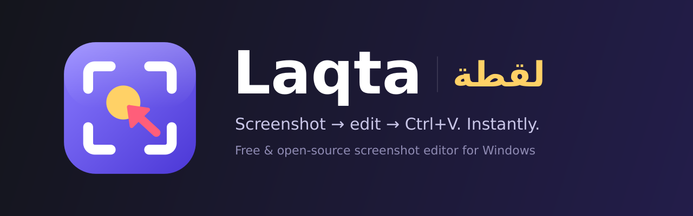
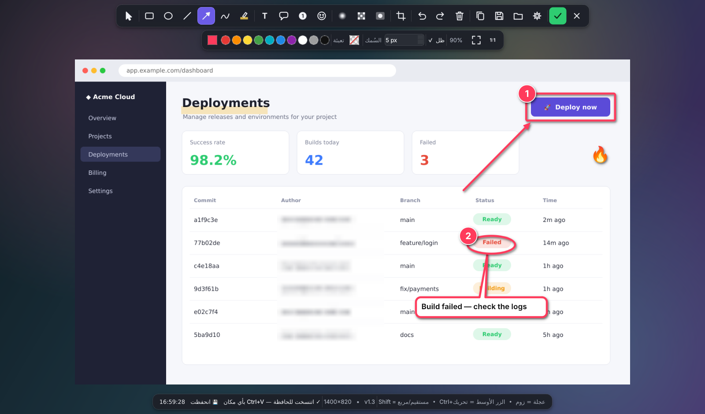
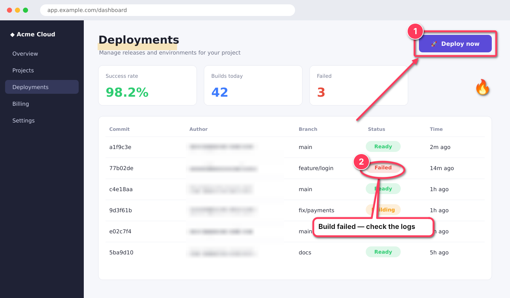
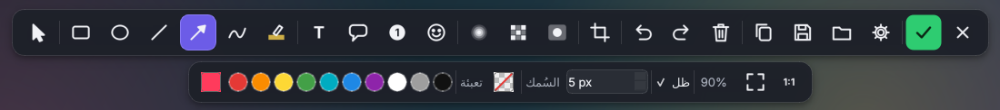
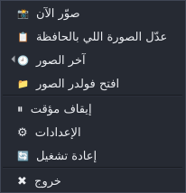
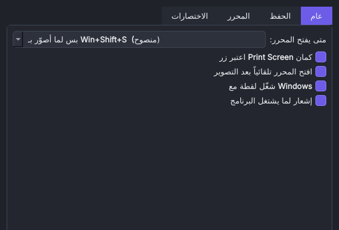
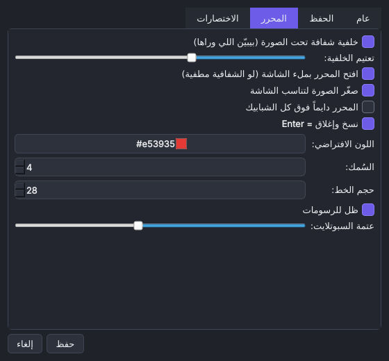

<p align="center">
  
</p>

<p align="center">
  <a href="#-التنزيل-والتشغيل"><b>التنزيل</b></a> •
  <a href="#-طريقة-الاستخدام"><b>الاستخدام</b></a> •
  <a href="#-وضع-المطوّر--عدّل-بدون-ما-تعيد-التشغيل"><b>وضع المطوّر</b></a> •
  <a href="#-english"><b>English</b></a>
</p>

<p align="center">
  
  
  
  
</p>

<div dir="rtl">

## 📸 شو هي لقطة؟

**لقطة** برنامج صغير ومجاني بيشتغل بالخلفية على Windows. بتصوّر الشاشة بـ **Win+Shift+S** زي العادة، وبيفتحلك المحرر فوراً فوق الشاشة. بترسم أسهم ومستطيلات وبتكتب وبتغبّش الأشياء الحساسة، وكل تعديل **بيتنسخ للحافظة لحاله**. بعدها **Ctrl+V** بأي شات وخلص.

ما في "حفظ" وما في "نسخ" وما في فتح برنامج ثاني.

</div>

<p align="center">
  
</p>

<div dir="rtl">

<p align="center"><i>المحرر بيفتح فوق شاشتك بخلفية شفافة. والصورة تحت هي اللي بتنلصق لما تعمل Ctrl+V 👇</i></p>

</div>

<p align="center">
  
</p>

<div dir="rtl">

## ✨ المميزات

- ⚡ **تلقائية بالكامل:** صوّر بـ Win+Shift+S، المحرر بيفتح لحاله، وكل تعديل بينسخ للحافظة وبينحفظ كملف.
- 🧰 **15 أداة:** تحديد وتحريك، مستطيل، دائرة، خط، سهم، قلم حر، هايلايتر، نص، فقاعة كلام، ترقيم خطوات، إيموجي، تغبيش، بكسلة، سبوتلايت، وقص.
- 🪟 **خلفية شفافة:** المحرر بيطلع فوق شاشتك، وبتتحكم بدرجة التعتيم.
- 🎨 ألوان سريعة، تعبئة شفافة أو كاملة، ظلال، وسُمك وحجم خط.
- ↔️ نقاط على الأطراف لتكبير وتحريك أي شكل، وتحريك ذيل فقاعة الكلام.
- ⌨️ اختصار لكل أداة، **وبيشتغل حتى لو الكيبورد على العربي**.
- ↶ تراجع وإعادة بلا حدود، وزوم وتحريك للصورة.
- 🇸🇦 دعم كامل للكتابة بالعربي.
- 🔒 بيشتغل على جهازك بس. ما في إنترنت، ولا رفع صور، ولا حسابات.

<p align="center">
  
</p>

---

## 📥 التنزيل والتشغيل

### الطريقة 1: ملف exe جاهز (الأسهل)

1. روح على صفحة [**Releases**](https://github.com/cortexaa-ai/laqta/releases) ونزّل `Laqta.exe`.
2. حطّه بفولدر ثابت، مثلاً `C:\Tools\Laqta\`، لأنه بيشتغل مع Windows من هاد المكان.
3. دبل كليك عليه. بتطلع الأيقونة البنفسجية جنب الساعة ✅

> 💡 إذا Windows SmartScreen حذّرك، اكبس **More info ← Run anyway**. هاد طبيعي مع أي برنامج جديد مش موقّع.

### الطريقة 2: من الكود (للمطورين)

1. نزّل [Python 3.9 أو أحدث](https://www.python.org/downloads/). وقت التنزيل علّم ✅ على **Add python.exe to PATH**.
2. نزّل المشروع:
   ```bash
   git clone https://github.com/cortexaa-ai/laqta.git
   cd laqta
   ```
   أو من زر **Code ← Download ZIP** وفك الضغط.
3. دبل كليك على **`install_and_run.bat`**. بينزّل المكتبات وبيشغّل البرنامج بالخلفية.

أو يدوياً:
```bash
pip install -r requirements.txt
pythonw laqta.py
```

### ✅ تأكد إنه شغّال

- بتطلع أيقونة **لقطة** البنفسجية جنب الساعة. إذا ما شفتها، اكبس على السهم **^** جنب الساعة (Windows بيخبي الأيقونات الجديدة هناك).
- صوّر بـ **Win+Shift+S** والمحرر لازم يفتح لحاله.
- رقم النسخة بيبيّن بالشريط اللي تحت بالمحرر.

---

## 🖱 طريقة الاستخدام

1. **صوّر:** Win+Shift+S وحدد المنطقة (أو زر Print Screen).
2. **عدّل:** المحرر بيفتح لحاله. اختار أداة وارسم.
3. **الصق:** Ctrl+V بأي مكان. الصورة المعدّلة جاهزة بالحافظة من أول ما ترسم.
4. **Enter** بينسخ وبيسكّر المحرر.

### ⌨️ الاختصارات

| الأداة | الاختصار | | الأمر | الاختصار |
|---|:---:|---|---|:---:|
| تحديد وتحريك | `V` | | نسخ وإغلاق | `Enter` |
| مستطيل | `R` | | تراجع / إعادة | `Ctrl+Z` / `Ctrl+Y` |
| دائرة | `E` | | نسخ | `Ctrl+C` |
| خط | `L` | | حفظ باسم | `Ctrl+S` |
| سهم | `A` | | حذف المحدد | `Delete` |
| قلم حر | `P` | | إلغاء التحديد / إغلاق | `Esc` |
| هايلايتر | `H` | | ملاءمة للشاشة | `Ctrl+0` |
| نص | `T` | | زوم | `Ctrl` + عجلة الماوس |
| فقاعة كلام | `B` | | تحريك الصورة | زر الماوس الأوسط |
| ترقيم خطوات | `N` | | خط مستقيم / مربع / دائرة | اضغط `Shift` وإنت بترسم |
| إيموجي | `J` | | تعديل نص أو فقاعة | دبل كليك عليه |
| تغبيش | `X` | | | |
| بكسلة | `Q` | | | |
| سبوتلايت | `F` | | | |
| قص | `C` | | | |

### 🗂 قائمة الأيقونة (كليك يمين جنب الساعة)

<p align="center"></p>

صوّر الآن • عدّل الصورة اللي بالحافظة • آخر 10 صور • افتح فولدر الصور • إيقاف مؤقت • الإعدادات • إعادة تشغيل • خروج

### ⚙ الإعدادات

<p align="center">
  
  
</p>

| التبويب | شو فيه |
|---|---|
| **عام** | متى يفتح المحرر (بس بعد Win+Shift+S أو أي صورة تنسخها)، زر Print Screen، التشغيل مع Windows، الإشعارات |
| **الحفظ** | نسخ تلقائي، حفظ تلقائي، فولدر الحفظ، اسم الملف، PNG أو JPG وجودته |
| **المحرر** | الخلفية الشفافة ودرجة التعتيم، اللون والسُمك وحجم الخط والظل الافتراضي، عتمة السبوتلايت |
| **الاختصارات** | كل الاختصارات بمكان واحد |

> الإعدادات بتنحفظ بـ `%APPDATA%\Laqta\settings.json`، والصور بفولدر `Pictures\Laqta` (حتى لو فولدر الصور على OneDrive).

---

## 🔧 وضع المطوّر: عدّل بدون ما تعيد التشغيل

لو بدك تعدّل على الكود، مش لازم كل مرة تسكّر البرنامج من جنب الساعة وترجع تشغّله. شغّله **بوضع المطوّر**، وهو بيعيد تشغيل حاله أول ما تحفظ الملف.

### طريقة الشغل

1. سكّر لقطة إذا كانت شغّالة. (أو لا تسكّرها، النسخة الجديدة بتسكّر القديمة لحالها.)
2. دبل كليك على **`dev.bat`** (أو من التيرمنال: `python laqta.py --dev`).
3. افتح `laqta.py` بأي محرر (VS Code مثلاً)، عدّل، واعمل **Ctrl+S**.
4. خلال ثانية البرنامج بيعيد تشغيل حاله بالكود الجديد ✨

### شو بيصير بالضبط لما تحفظ؟

```
حفظت laqta.py
   │
   ├─ بيفحص الكود: في خطأ بالكتابة (Syntax Error)؟
   │     ├─ آه ← ما بيعيد التشغيل. النسخة الحالية بتضل شغّالة،
   │     │       وبيطلعلك إشعار فيه الخطأ ورقم السطر.
   │     └─ لا  ← بيكمّل ⬇
   │
   ├─ إذا كان المحرر مفتوح على صورة ← بيحفظها مؤقتاً
   ├─ بيسكّر النسخة القديمة
   └─ بيشغّل نسخة جديدة، وبيرجع يفتح نفس الصورة
       عشان تشوف تعديلك فوراً على نفس الصورة 👌
```

### نصايح

- **خلّي شباك `dev.bat` مفتوح.** أي `print()` أو خطأ وقت التشغيل بيطلع فيه.
- بوضع المطوّر البرنامج **ما بيسجّل حاله بتشغيل Windows**، عشان ما يخرّب على النسخة اللي بتستخدمها عادة.
- بدك تعيد التشغيل يدوياً؟ كليك يمين على الأيقونة ← **🔄 إعادة تشغيل**.
- تغييرات **الإعدادات** (من نافذة الإعدادات) ما بتحتاج إعادة تشغيل. بتشتغل من أول صورة جديدة.
- لو صار خطأ والبرنامج وقف، تفاصيله بتنحفظ بـ `%APPDATA%\Laqta\error.log`.

### وين ألاقي الأشياء بالكود؟

| بدك تعدّل… | روح على |
|---|---|
| شكل أداة أو طريقة رسمها | الكلاسات `RectAnno`, `ArrowAnno`, `PenAnno`, `BlurAnno`, … |
| تضيف أداة جديدة | `TOOLS` (فوق) + `make_icon()` + `Editor.make_item()` |
| ألوان وشكل الواجهة | `EDITOR_QSS` و `PALETTE` |
| الأيقونات | `make_icon()` (مرسومة بالكود) |
| القيم الافتراضية | `DEFAULTS` |
| نافذة الإعدادات | `SettingsDialog` |
| متى يفتح المحرر (مراقبة الحافظة والاختصار) | `KeyWatcher` و `LaqtaApp.check_clipboard()` |

---

## 📦 بناء ملف exe

```bash
build_exe.bat
```
بيطلّع `dist\Laqta.exe`، ملف واحد فيه كل إشي مع اللوجو، وما بيحتاج Python عند اللي بيستخدمه.

**عشان تنشره بـ Releases:** ارفع `dist\Laqta.exe` على صفحة GitHub Releases مع رقم النسخة (مثلاً `v1.4`).

---

## 🩺 حل المشاكل

| المشكلة | الحل |
|---|---|
| ما في أيقونة جنب الساعة | شوف تحت السهم **^**. أو شغّل `debug.bat` وصوّر الشباك. |
| المحرر ما بيفتح بعد Win+Shift+S | تأكد إن البرنامج مش **موقّف مؤقتاً** من قائمة الأيقونة. |
| شغّال على نسخة قديمة | شوف رقم النسخة بالشريط تحت. شغّل البرنامج من جديد وهو بيسكّر القديم لحاله. |
| بيفتح Snipping Tool كمان | افتح Snipping Tool ← ⋯ ← Settings، واطفي **Automatically copy changes**. |
| وقف فجأة | التفاصيل بـ `%APPDATA%\Laqta\error.log`. افتح Issue وحطها فيه. |
| بدي أوقف التشغيل مع Windows | الإعدادات ← عام ← شيل ✅ عن "شغّل لقطة مع Windows". |

---

## 🗂 ملفات المشروع

```
laqta/
├── laqta.py              ← البرنامج كله
├── requirements.txt      ← المكتبات (PySide6)
├── install_and_run.bat   ← تنزيل وتشغيل بكبسة
├── dev.bat               ← وضع المطوّر (إعادة تشغيل تلقائية)
├── debug.bat             ← تشغيل مع إظهار الأخطاء
├── build_exe.bat         ← بناء Laqta.exe
├── assets/               ← اللوجو (svg, png, ico)
└── docs/                 ← صور الـ README
```

## 🤝 المساهمة

أهلاً فيك! افتح **Issue** لأي مشكلة أو فكرة، أو اعمل **Pull Request**:
1. Fork ← فرع جديد `feature/my-idea`.
2. اشتغل بـ `dev.bat` عشان تشوف تعديلاتك فوراً.
3. ابعت PR بوصف قصير وصورة إذا في تغيير بالشكل.

## 📄 الرخصة

[MIT](LICENSE) © 2026 Omar Mohamed / [Cortexaa AI](https://github.com/cortexaa-ai)

</div>

---

## 🇬🇧 English

**Laqta** (Arabic for *"snapshot"*) is a free, lightweight screenshot editor for Windows that lives in your system tray.

1. Take a screenshot with the native **Win+Shift+S** (or Print Screen).
2. The editor pops up instantly as a transparent overlay.
3. Annotate. **Every edit is auto-copied to the clipboard** (and auto-saved).
4. **Ctrl+V** anywhere. Done.

**Tools:** select/move, rectangle, ellipse, line, arrow, freehand pen, highlighter, text, speech balloon, step numbers, emoji stickers, blur, pixelate, spotlight, crop. Plus resize handles, shadows, a quick palette, fill colors, zoom/pan, unlimited undo/redo, full Arabic/RTL text support, and per-tool shortcuts that work on any keyboard layout.

### Install
- **Easiest:** download `Laqta.exe` from [Releases](https://github.com/cortexaa-ai/laqta/releases), put it in a permanent folder, and run it.
- **From source:** Python 3.9+, then
  ```bash
  pip install -r requirements.txt
  pythonw laqta.py
  ```
  or just double-click `install_and_run.bat`.

### Developer mode (hot restart)
Run `dev.bat` (or `python laqta.py --dev`). Laqta watches `laqta.py`, and every time you save:
- it syntax-checks the file. On an error it **keeps the current instance running** and shows the error in a notification and the console;
- otherwise it restarts itself in about a second and **re-opens the image you were editing**, so you see your change immediately.

Dev mode never registers itself for Windows startup. You can also restart manually from the tray menu (**🔄 Restart**).

### Build
`build_exe.bat` produces a single `dist\Laqta.exe` (PyInstaller) with the logo embedded.

### Privacy
Everything runs locally. No network access, no uploads, no accounts.

Built with Python + PySide6 (Qt). MIT licensed.
